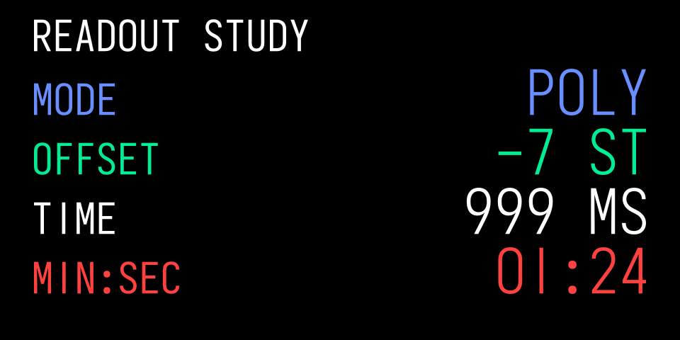
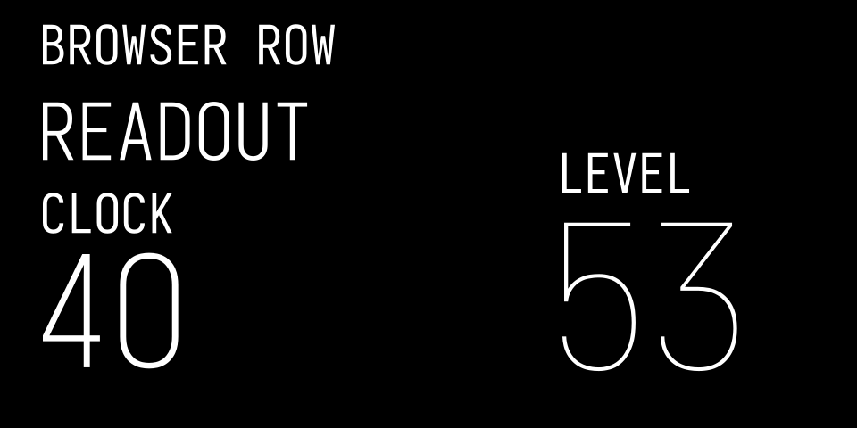
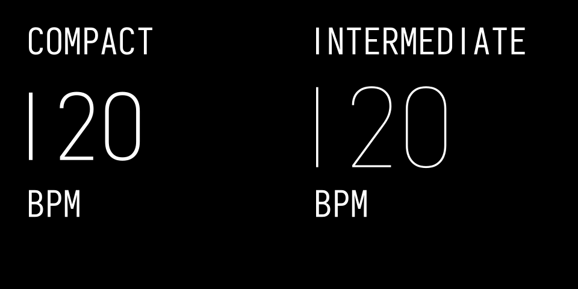

# Iosevka Host Preview Font

The kit bundles **Iosevka 34.9.0** in four upright, normal-width weights for
public example renders and host previews. Choose a text size and use its
matching weight; the supplied renderers do this automatically. It is an openly licensed placeholder.
It does not reproduce the stock OP-1 font’s outlines, spacing, icons or native
text behaviour. The typography roles and sizes still come from the stock
interface; changing the preview font does not change those references.

## Bundled Font Files

The files are in `skills/op1-design/` in this repository. If you installed the
skill separately, use its `op1-design/` folder instead. Paths below start there:

| File | Use |
| --- | --- |
| `assets/fonts/Iosevka-{Thin,ExtraLight,Light,Regular}.woff2` | Four unmodified font files. No download or system installation needed for browser use. |
| `assets/fonts/Iosevka-OFL.md` | Copyright and SIL Open Font License 1.1. Keep this with redistributed font files. |
| `assets/fonts/profile.json` | Version, checksums, sources, size-to-weight mapping, character set and exact OpenType variants. |
| `assets/fonts/metrics.json` | Bounds and advances for the selected Iosevka glyphs in each weight. These are open-font metrics, not stock metrics. |
| `assets/fonts/preview-font.mjs` | Browser loader and adapter for the kit scene format. |
| `scripts/preview_font.py` | Open-font SVG renderer and measurements for the same scene format. |

Source: [Iosevka by Renzhi Li](https://github.com/be5invis/Iosevka/tree/v34.9.0).
The font keeps its own OFL licence; the kit’s original adapters are MIT.

## Match Weight To Text Size

Use this mapping for Iosevka host previews. The size names belong to the kit;
the weights are preview choices, not TE font settings.

| Kit Size | Iosevka Weight | Example Use |
| --- | --- | --- |
| XS | Regular 400 | Parameter names, units and browser rows |
| S | Light 300 | Short values such as `64` or `999 MS` |
| M | ExtraLight 200 | Compact BPM readout |
| L | ExtraLight 200 | Dominant time readout |
| XL | Thin 100 | A larger BPM readout |
| XXL | Thin 100 | Large lane level numerals |

The screen’s reading task helps you choose a size. That size then determines
the preview weight. Applying Thin 100 to every size makes small labels faint;
applying Light 300 everywhere makes the largest numbers too heavy. Changing
weight with size keeps a more consistent stroke presence across the screen.
This is based on local host comparisons with representative stock-reference
size and stroke profiles. It does not establish native kerning or OLED legibility.

Keep the mapping when enlarging or reducing a whole preview. An XS label
rendered at 2× is still XS with weight 400. Do not choose weight from the final
PNG dimensions, browser zoom or the word’s semantic role. Keep the selected
character variants the same across weights. Use actual metrics for each weight
when checking text fit; a shared family name does not give shared ink bounds.

### Labels And Short Values



*Original code render with Iosevka. Names use XS/400 and values use S/300.
Signs, units and the complete timer string stay within their fields.*

### Larger Numbers



*Original code render with Iosevka. Labels stay readable while L/200 and
XXL/100 numerals remain relatively light. The numbers are example values.*



*Original code render with Iosevka. Both rate layouts use the same size-to-weight
mapping as the other examples. These are kit studies, not stock screenshots.*

The [visual index](VISUALS.md#typography-size-and-weight) links their scene data.

## Host Previews And Native Screens

Use the bundled Iosevka profile for host-generated previews, screenshots and
public examples. Use the platform’s stock text route in the emulator or on
hardware with your own firmware. Do not copy the stock font into a plugin,
webpage, public example or skill package. Keep any explicit local font research
private; the kit provides no permission to redistribute TE assets.

## Use The Selected Variants

Loading the family name alone gives different digits. Apply the profile’s
features in browsers and other shaping engines:

```css
font-family: OP1KitPreview;
/* XS example; use the table above for other logical sizes. */
font-weight: 400;
font-synthesis: none;
font-style: normal;
font-feature-settings:
  "cv01" 1, "cv02" 1, "cv03" 1, "cv04" 1, "cv05" 1,
  "cv06" 1, "cv07" 1, "cv08" 2, "cv09" 3, "cv10" 1,
  "cv19" 1;
```

This selects a plain 1, straight-neck 2, flat-top 3, closed 4, upright 5,
rounded closed-contour 6, straight 7, two-circle 8, straight diagonal-tail 9,
unslashed 0 and serifless capital I. These are built-in font variants.
Do not substitute a character from another font or stretch the glyphs.
Consult the [versioned variant reference](https://github.com/be5invis/Iosevka/blob/v34.9.0/doc/character-variants.md)
when changing the profile.

## Size And Align The Visible Lettering

The font has 1,000 units per em and a 735-unit cap height. A kit profile’s
`nominalHeight` describes a stock centreline reference. To approximate its
full visible height, include the profile’s stroke width:

```text
scale = (nominalHeight + strokeWidth) / 735
CSS font size = scale * 1000
baseline = top-of-cap-cell + nominalHeight + strokeWidth / 2
```

Use the font’s own advances between characters. Anchor the completed string
by its visible ink bounds, not the last cursor advance. This matters for a
final 1 or I. Lay out a value and unit together, preserving their ink gap and
shared anchor. Measure again after changing a string; do not use schematic
or stock widths with Iosevka.

The slash extends above and below the capital cell. Check actual ink bounds
for `1/3`, signs, underscores and other punctuation, particularly near the
bottom guide. Keep complete strings inside their field and clear of artwork.
Reflow or move a field when needed; do not silently shrink it.

## Browser Use

The supplied loader registers the family as `OP1KitPreview`.
Serve the installed skill folder as local static files, or copy all four fonts,
notice, profile, metrics, adapter and its `scripts/lib/` imports into your
host’s asset tree while preserving the relative paths. Use localhost or HTTPS
for the adapter’s checksum verification. It loads local bundled assets and
uses no font CDN.

```js
import {loadPreviewFont, applyPreviewFont} from './path/to/op1-design/assets/fonts/preview-font.mjs';
const font = await loadPreviewFont();
// Insert your kit-format SVG in the document before applying the adapter.
const issues = applyPreviewFont(svg, scene, font);
```

The adapter selects a weight from each text record’s size and uses that
weight’s selected glyph metrics. It leaves the original
artwork in place and checks text widths, content guides and artwork clearance.
This produces a host SVG with SVG text; it is not firmware SVG source.

## Static Renders

The portable Python helper needs Python 3.11 or later, Node.js for its layout
check and the Python packages pinned in `scripts/requirements-preview.txt`
inside the installed skill. Install those requirements in a local virtual
environment with `python -m pip install -r /path/to/op1-design/scripts/requirements-preview.txt`.
The repository also provides the same pins in
`op1-ui/tools/requirements-preview.txt`. With that environment active:

```sh
python3 scripts/preview_font.py screen.json --svg preview.svg
```

The scene format is in [Verification](VERIFICATION.md). Use a browser or your
SVG rasteriser to capture pixels. In the repository, run
`python3 op1-ui/tools/render_preview.py` to rebuild every public example and
the Open Graph image. It uses the bundled font and needs no firmware.
`--output out/preview-review` writes a review set without replacing the public
images. Keep captures labelled **Iosevka preview** and inspect them at 320 × 160
as well as enlarged.

## Characters And Limits

The profile exposes uppercase A–Z, 0–9, space and the punctuation listed in
`textCharacters`. Missing characters fail explicitly. Iosevka has a much larger
character set, but that does not establish support on an OP-1. The stock icon
IDs are a separate namespace and are not Iosevka characters.

The rounded 6 and diagonal 9 follow the intended construction, while the 9’s
loop, several bowls, proportions and spacing remain visibly different from
stock. A clear Iosevka preview establishes composition under that font only.
For stock lettering, check the emulator or hardware using your own firmware
and its stock text route. [Fonts And Previews](FONTS.md) also describes the
separate private font-research tools. Never
publish the private font, its geometry or a stock-lettering export from that
check.
