# Screen Families And Design Language

Study how an OP-1 screen makes its instrument understandable. Some screens use
an illustrated object, some a diagram and others a repeated set of controls.
Look at how each layout helps the player use the instrument. The lessons below
can help you design a screen with its own identity.

| Screen Family | Design Lesson | What To Preserve In A New Application |
| --- | --- | --- |
| Synth engines such as FM, String and DBOX | The graphic gives the engine a recognisable identity and explains a sound relationship | A strong silhouette or mechanism, control ownership and space for useful readouts |
| Synth envelope and note settings | A curve or setting relationship can be the interface itself | Stable reference points, readable stages and supporting values outside the graphic |
| Synth and drum samplers | Overview and detail serve different tasks | Context, clear boundaries and a distinction between selection and live playback |
| Effects such as Delay and Spring | An object or spatial metaphor makes an effect understandable | The relationship between the effect’s controls and its distinctive graphic |
| LFOs | Source, amount and destination form a route | Clear direction, destination identity and a distinction between configuration and activity |
| Pattern, Endless, Sketch and Tombola | Different sequencers represent different musical processes | Events, play position and system controls that remain distinguishable |
| Tape and Album | The machine and its motion explain transport, recording and time | Reel or recording identity, a readable state and motion tied to musical progress |
| Mixer | Four repeated lanes make the physical controls predictable | Lane order, stable positions and separate jobs for level and pan |
| EQ and Master | A shared reference helps the player compare frequency or level behaviour | A neutral line or scale and a distinction between settings and live metering |
| Tempo and input pages | A dominant number or source state can lead a supporting control group | Clear hierarchy, relevant units and unambiguous source/clock state |

The [FM, String and Digital references](https://squarewave-studio.github.io/op1-design-kit/examples.html#stock-synth-screens)
contrast embedded values, physical-model imagery and sparse geometry. DBOX is
one additional grouping example, not the template for every engine.

The [pattern studies and original applications](https://squarewave-studio.github.io/op1-design-kit/examples.html)
show how to carry a relationship into a new screen. They are independent
compositions, not copied stock drawings. A close study should explain the
reference’s grouping, visual centre, hierarchy and colour ownership; a new
application should give those relationships its own object and controls.

## Stock Templates And The Kit Grid

The stock UI uses screen-specific artwork, named regions and text templates.
For example, the synth sampler has distinct overview and magnified waveform
regions. Its native binding uses those regions to place live waveform drawing,
and creates its gain readout from a text template. The artwork supplies layout;
the screen code supplies the changing information.

These layouts offer **patterns you can reuse**. They do not show that TE used
one grid or component library. Stock artwork has fractional positions and
different arrangements for different tasks; an underlying authoring grid
remains unconfirmed. The kit’s 8-unit construction grid is an optional
community recommendation. See [Layout And Grid](https://squarewave-studio.github.io/op1-design-kit/spec.html#layout-and-grid).

## Interaction Patterns From Stock

The following lessons combine stock composition with documented controls.
“Stock reference” describes the original example; “Use the pattern” is this
kit’s recommendation for a new design. A static resource can contain several
alternative states together, so it cannot establish when each state appears.

Original example renders below show how to apply each relationship. Each image
is a complete 320×160 logical screen. Paired states sit side by side on wider
screens and stack on phones. They are host renders of original kit artwork,
not stock screenshots or implemented plugins. PNGs use the bundled Iosevka placeholder. Iosevka is included under OFL; stock font resources are not included.

The [visual index](VISUALS.md) includes the editable schematic SVGs, control
maps, state descriptions and boundary checks. Choose a pattern and compare its two states.

### Keep Context Beside Detail

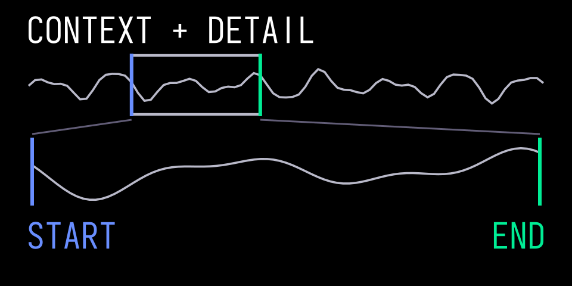 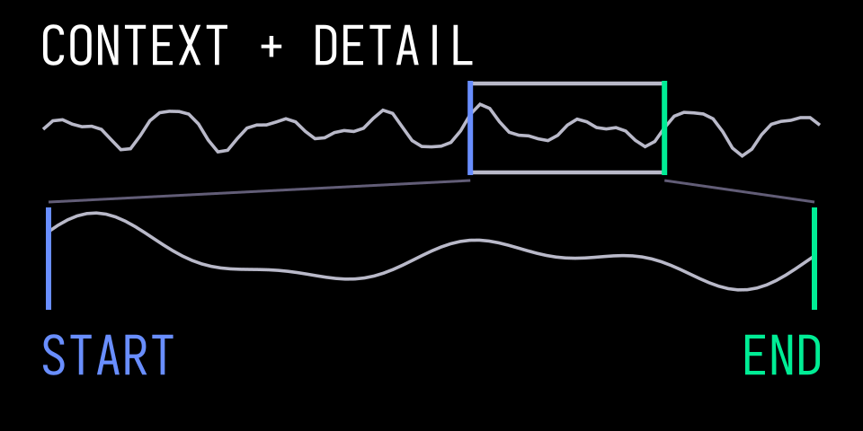

*First span, then a later span. Matching Blue and Green boundaries connect the compact overview to the detail region. Both frames stay fixed; only the selected interval and detailed waveform change.*

**Stock reference:** the synth sampler gives a compact waveform overview a
separate region above a larger waveform area. These are separate layout
regions used by native waveform drawing, rather than one decorative SVG wave.

**Use the pattern:** keep the whole phrase visible while editing a slice or
loop boundary in detail. Mark the detailed region’s relationship to the whole.
Give the views distinct jobs; a second waveform should add context rather than
duplicate the first. This recommendation does not establish stock automatic
zoom, viewport tracking or their input controls.

### Separate Editing Focus From Playback

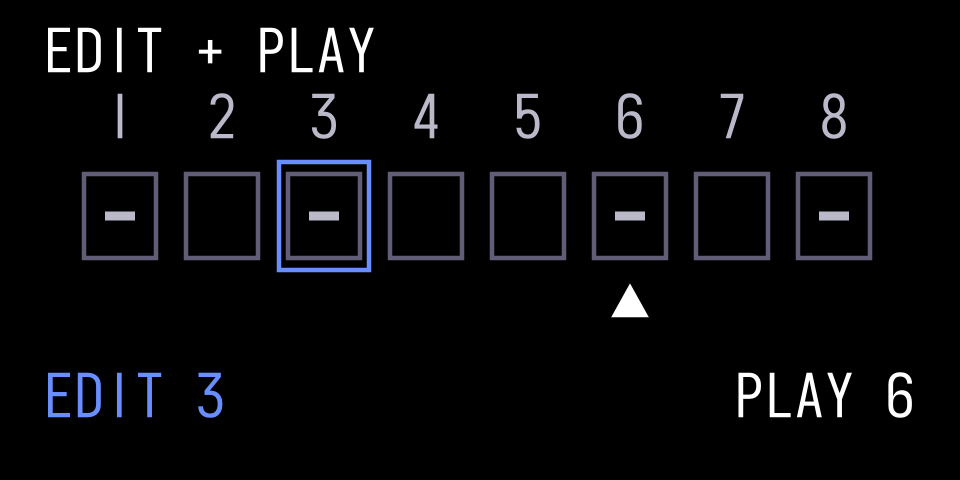 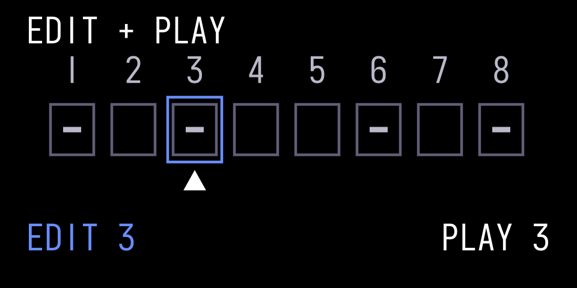

*Playback at step 6, then at step 3. The Blue edit outline stays on step 3; the White playback triangle remains distinct even when they coincide. Grey marks represent stored events.*

**Stock reference:** Pattern supports live editing with the editing position
decoupled from playback. Its resource also separates the note field and edit
pointer. The resource alone does not establish the final cursor appearance.
See [Pattern, §7.6](https://teenage.engineering/guides/op-1/original/sequencers).

**Use the pattern:** distinguish stored events, the item being edited and
current playback activity. For example, keep an edit outline on step 3 while
a separate progress marker crosses step 6. Choose original markers whose
shape and position remain distinguishable when they coincide. An activity
flash must not make it unclear which event the next encoder turn will edit.

### Show The Category And The Choice Together

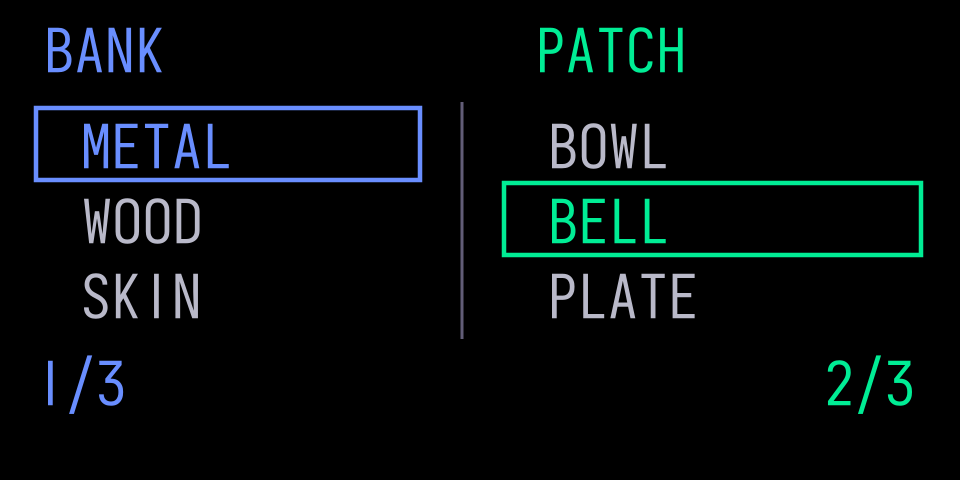 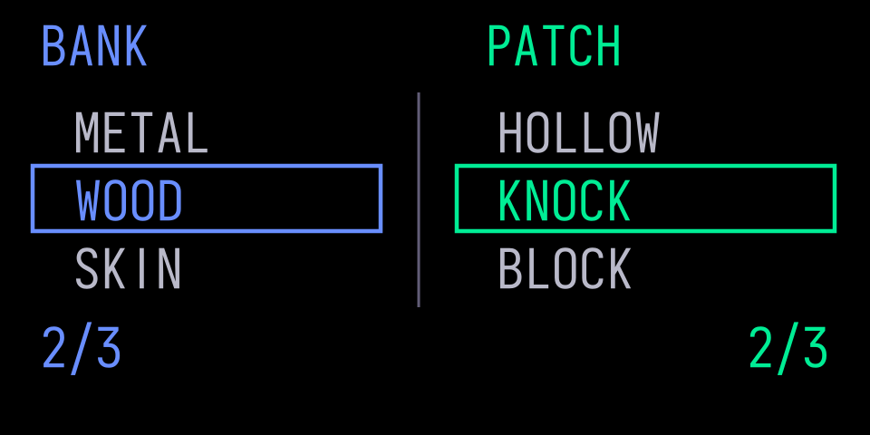

*METAL / BELL, then WOOD / KNOCK. Blue changes the bank and its available items; Green owns the patch choice. The new bank receives an explicit valid item choice. Empty and long-name fixtures are in the visual contract.*

**Stock reference:** the preset browser separates engine types and presets
into two lists with distinct selection regions. Blue chooses the type and
Green chooses the preset. See [Changing Sound, §5.7](https://teenage.engineering/guides/op-1/original/synthesizer-mode).

**Use the pattern:** keep a category visible while choosing one of its items.
A bank/patch or model/variation browser can use the same relationship without
adding a deep menu. Make each current choice and encoder owner clear. Define
what happens to the item choice when the category changes; do not infer wrapping,
audition, scrolling animation or confirmation from the stock drawing.
Check an empty category, long names and returning to the browser. Distinguish
a highlighted candidate from an applied choice wherever confirmation is required.

### Let Shift Explain The Alternate Function

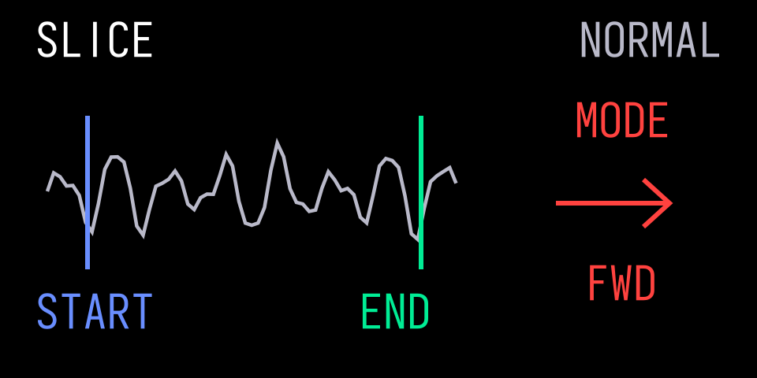 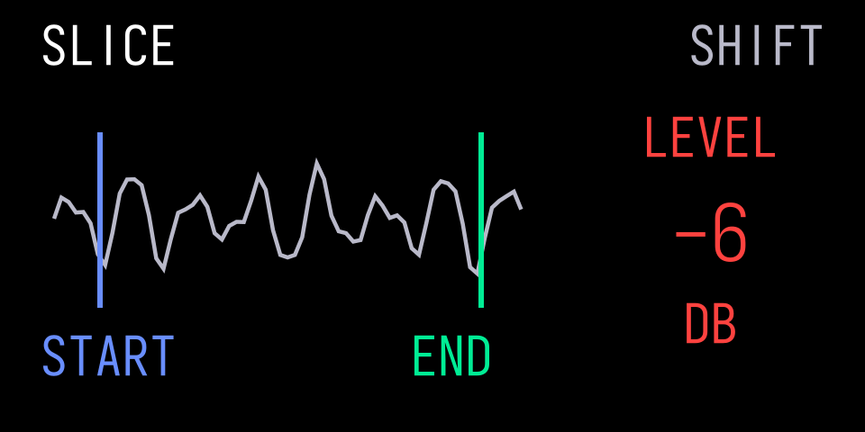

*Normal, then held Shift. The waveform, boundaries and Orange ownership remain fixed. The mode arrow becomes a level readout with a name and unit. Releasing Shift returns to the first presentation; both underlying values are retained.*

**Stock reference:** the drum sampler’s Orange presentation can change from a
playback-mode arrow to a level number under Shift. The sampler assets contain
alternate presentation elements, and stock input dispatch distinguishes normal
and Shift encoder lanes. See [Shift + Encoders, §14.5](https://teenage.engineering/guides/op-1/original/shift-key).

**Use the pattern:** show the alternate label, value and unit while that control
is available, retaining its colour and a clear positional relationship. If
Shift only provides finer adjustment, keep the same parameter identity; do not
pretend it is a different function. For a held Shift presentation, check that
release restores the normal view without changing either parameter unexpectedly,
and that returning to the page preserves the intended values.
Showing a Shift group does not implement the input route or preserve its state.

### Explain A Route Without Repeating Every Control

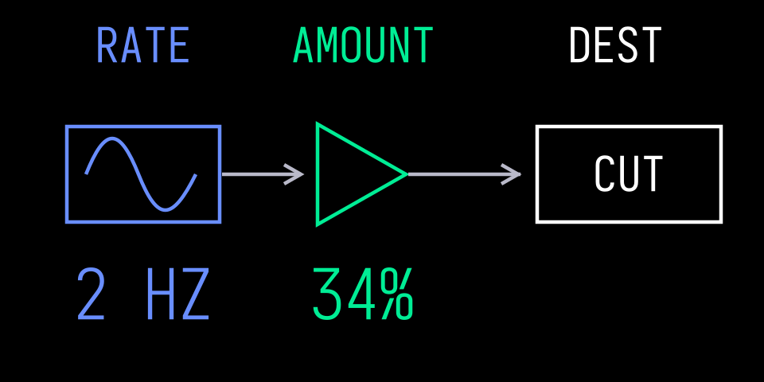 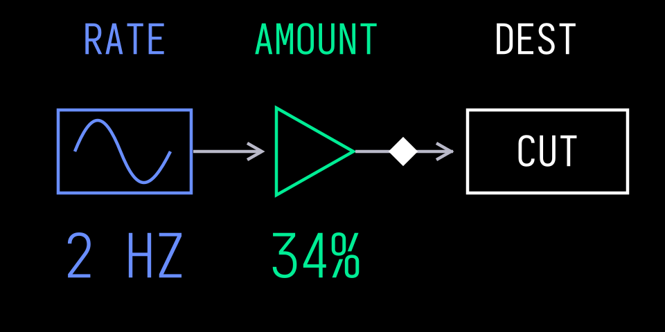

*Inactive, then active. The configured rate, percentage amount and CUT destination do not change. A small White activity diamond appears on the directed route; it is a signal indicator, not editing focus. This is an explanatory overview.*

**Stock reference:** Signal Flow uses connected source, processing and output
symbols to explain the instrument’s larger system. Shift + Mixer provides that
overview. The stock LFO compositions also distinguish a source/rate, amount and
destination. See [Main Modes, §4.2](https://teenage.engineering/guides/op-1/original/main-modes)
and [LFO Reference](https://teenage.engineering/guides/op-1/original/lfo).

**Use the pattern:** give a modulation or effects overview a clear direction
and distinguish configuration from activity. For example, a source → amount →
destination diagram can explain a route while a separate marker shows current
signal activity. Do not make a node look selectable unless it has an actual
selection action. An overview can be explanatory rather than another editor.

### Match The Readout To The Kind Of Value

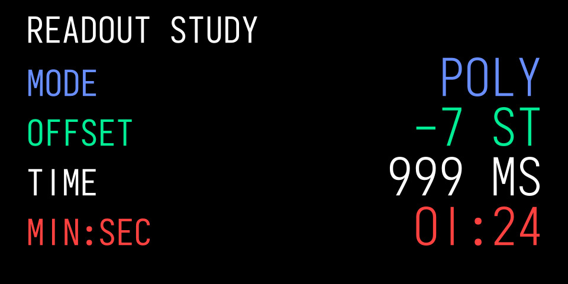 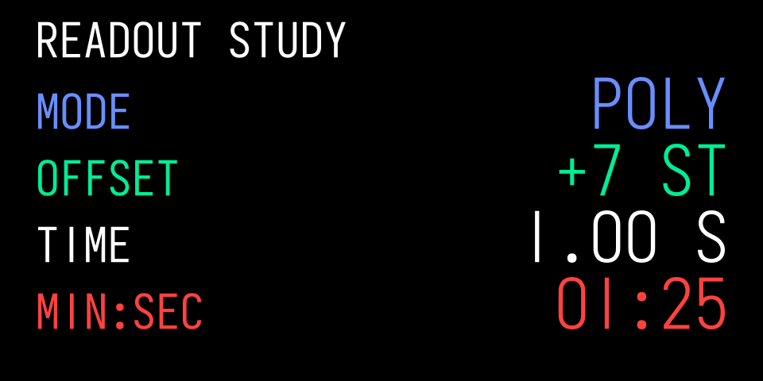

*Readout study, not an engine proposal. Category, signed semitone offset, duration and minutes:seconds position use deliberate formats. The sign and duration unit change while label positions, type profiles and right readout edges stay fixed.*

**Stock reference:** Play Mode pairs names with categorical and numeric values;
Tempo contains separately sized BPM text templates; Clock separates time digits.
Choose a readout layout that suits the value and the available space.

**Use the pattern:** show an enum as a recognisable choice, a signed offset with
its sign, a duration with its unit and a time position in a stable format. Use
the [stock-derived typography profiles](https://squarewave-studio.github.io/op1-design-kit/spec.html#typography-from-the-original-op-1)
for the reading task. Predefine the formats and layout variants a design needs;
do not infer stock switching thresholds from template names or auto-shrink any
string until it fits. Check format transitions as well as minimum and maximum values.

### Make Motion Explain The Musical Mechanism

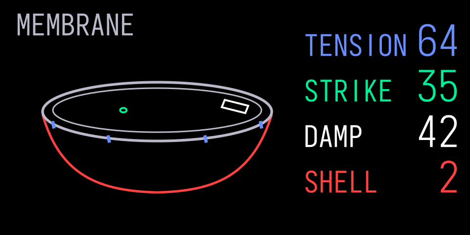 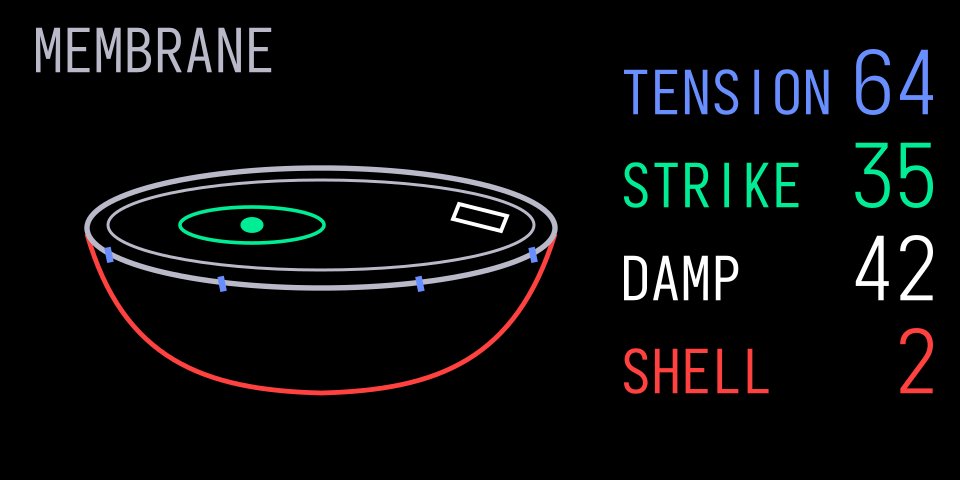

*Membrane at rest, then responding to a strike. Rim, camera, controls and readouts remain fixed. The small contact fills and one local ripple appears on the skin; the felt pad stays opaque in front of the response. A real event should start the response, which settles back to the first state. These are static poses, not an animation or timing claim.*

**Stock reference:** Tombola relates moving notes, gravity and rotation to
sequence generation. Its resource contains a container and separate note
templates; the documented behaviour supplies their musical meaning. See
[Tombola, §§7.7–7.8](https://teenage.engineering/guides/op-1/original/sequencers).

**Use the pattern:** preserve movement when it helps someone understand why a
musical event occurs. Define what starts and stops it, what a collision or
position means and which reference objects stay fixed. Reuse retained parts and
measure the supported update path. Check stopped, empty and rapidly retriggered
states. Activity feedback must follow real events and settle or stop according
to the instrument’s state. Neither a static drawing nor the metaphor
establishes a frame rate, a physics algorithm or a CPU budget. See
[meaningful motion](https://squarewave-studio.github.io/op1-design-kit/examples.html#4-give-motion-a-musical-job)
and [Graphics](https://squarewave-studio.github.io/op1-design-kit/graphics.html).

## Finding More Stock Examples

Use these sources when the kit’s original examples do not answer a specific
composition, typography or interaction question:

- **Existing local firmware:** use your own original OP-1 firmware and its
  unpacked `content/display/` resources. Establish the firmware version and
  inspect the relevant screen family, text templates and element groups.
  [Fonts And Previews](FONTS.md) explains the local resource location and links
  to op1repacker’s unpacking documentation. Keep the firmware and extracted
  resources private; they are reference inputs, not assets to add to a project.
- **Official manual:** go to [TE’s original OP-1 guide](https://teenage.engineering/guides/op-1/original)
  and choose the section for the reading task. [Synthesizer Mode](https://teenage.engineering/guides/op-1/original/synthesizer-mode)
  covers instrument and envelope relationships, [Drum Mode](https://teenage.engineering/guides/op-1/original/drum-mode)
  provides sampler and DBOX examples, [Sequencers](https://teenage.engineering/guides/op-1/original/sequencers)
  explains edit and playback relationships and [Shift](https://teenage.engineering/guides/op-1/original/shift-key)
  explains alternate functions. Use the manual as an external reference;
  the portable skill links to the manual without bundling its pages or illustrations.

For each relevant example, identify the reading order, parameter ownership,
text roles, aligned anchors, empty space and what changes with input. State
which source supports the observation. A manual illustration can explain a
composition; a local resource can reveal templates and alternative parts.
Neither alone establishes which parts appear together, animate or respond to
a control. Check a matching running screen for those claims. Adapt the useful
relationship into original artwork and test the complete value and state range.

## Use Reference Screens Carefully

Stock artwork can contain alternative poses, placeholders and labels that
native code selects, replaces or hides. A file preview may show several states
at once. Use a matching running screen when you need to establish actual
animation or runtime layout; do not infer the whole interaction from artwork.

Use your own firmware locally. No firmware resources are included or served
here. The website’s separately labelled manual quotations are attributed
reference excerpts, not reusable kit artwork. No manual images are bundled
with the skill.
Public PNG examples use original geometry and the bundled Iosevka placeholder.
Iosevka and its OFL licence are included. Stock font files and stock glyph
vectors are not supplied. The kit palette
is a set of named design tokens, not a promise of exact stock colours or OLED
calibration. See [Spec](https://squarewave-studio.github.io/op1-design-kit/spec.html).

## Layout Guidance You Can Apply Here

Use these working defaults when starting an original screen. They are kit
recommendations informed by community device reports, not a measured TE grid.

| Decision | Working Guidance |
| --- | --- |
| Canvas | Author in 320×160 logical units. Keep physical output scaling and framework offsets separate. |
| Construction grid | Start with 8-unit regions and 4-unit adjustments. Use it for anchors, not every curve vertex or glyph. |
| Outer margins | Start with top/right/bottom/left insets of 8/8/16/8. Include visible stroke extents. |
| Important content | Keep critical ink at or above y=140. The default safe rectangle reaches y=144; its final strip is clearance. |
| Group spacing | Start with 4 units between related elements, 8 between groups and 12 between sections, measured between visible bounds. |
| Readout alignment | Give names and values a deliberate shared edge or axis. Align a value and unit on the same baseline. |
| Moving graphics | Reserve the whole swept region, not just the rest pose. Keep readout anchors steady. |
| Strokes | Measure half the centred stroke on either side of its path. Check joins, fractional geometry and final output size. |
| Text fit | Reserve signs, longest values, units and Shift states. Reformat or make room rather than auto-shrink. |

For a screen with an instrument drawing on the left and readouts on the right,
reserve those two regions first. Measure each complete name/value/unit group,
then test the drawing’s most expanded state. A fixed 80-unit column pitch does
not guarantee 80 units of usable text space. The [layout diagram and detailed
examples](https://squarewave-studio.github.io/op1-design-kit/spec.html#layout-and-grid)
are included in this kit.

The cautious bottom guide reconciles two community observations: maxaw reports
about 147 usable units from the top; popcorp suggests keeping important content
above about y=140. Physical window alignment and display revisions still need a
check on the target. Neither report establishes a universal clipping boundary.

Source credit: [maxaw’s layout notes](https://op-forums.com/t/custom-firmware-on-the-op-1/4283/1371)
and [popcorp’s graphics notes](https://op-forums.com/t/custom-firmware-on-the-op-1/4283/1373).
The actionable rules are reproduced above in the kit’s own guidance.
